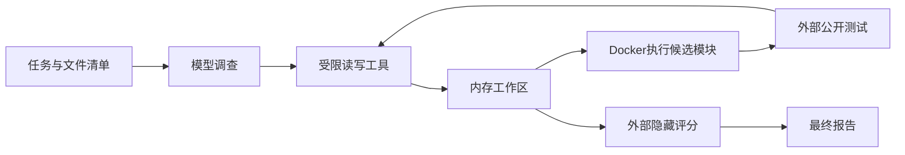

# 后续路线的首轮执行结果

执行路线见[五步计划](next-steps.md)。本轮完成预算复核，并打通多文件 Agent 原型；未开始真实仓库任务池校准或新一轮技能效果实验。

## 1. 输出预算复核

方案与脚本在执行前提交到 [fdb8252](https://github.com/zouzihao-666/SkillScope/commit/fdb8252)。固定第三阶段原 get-path 题目、原 6 份技能和原评分器，每组使用新的 5 次重复。

| 配置 | 1,024 tokens：通过/计划 | 截断 | 2,048 tokens：通过/计划 | 截断 |
| --- | ---: | ---: | ---: | ---: |
| 无技能 | 5/5 | 0 | 5/5 | 0 |
| 全部加载 | 4/5 | 1 | 5/5 | 0 |
| 反向加载 | 3/5 | 2 | 5/5 | 0 |
| 按阶段加载 | 5/5 | 0 | 5/5 | 0 |

全部 40 次运行完成，无接口或环境错误。3 次失败都为输出长度截断。实际 114 次模型请求、167,289 tokens，高峰价上界估算 USD 0.083289066，低于预设 USD 0.50 估算预算。

反向加载符合预先定义的预算敏感候选模式：低预算至少 2/5 截断，高预算 0/5 截断且全部通过。这里只观察到预算条件下的重复差异，尚不能证明指南发生语义冲突，也不能凭 5 次相关重复保证泛化。两档预算同时改变三个阶段的上限，不能单独归因于调查阶段。

后续原型暂用每次 2,048 tokens 作为开发起点，并继续记录成本与截断；不把它称为已经找到最优预算。第三阶段 148 条旧记录保持原样。

[完整报告](../artifacts/budget-study-20261123/report.md) · [费用与用量](../artifacts/budget-study-20261123/study.json) · [压缩原始记录](../artifacts/budget-study-20261123/raw-runs.jsonl.gz)

## 2. 多文件运行器原型

人工购物车夹具由金额解析、购物车汇总和包入口组成。原型提供列文件、读文件、允许范围内写文件和公开测试反馈；隐藏测试不进入模型消息。修改只允许在实现阶段，候选代码仅在 Docker 中执行。

参考实现先通过确定性检查：原始代码未通过公开测试；人工参考修复通过 2 项公开测试与 19 项隐藏测试。该检查模型调用为 0，不作为模型修复结果。

### 三次工程尝试全部保留

| 版本 | 执行前提交 | 请求次数 | tokens | 结果与解释 |
| --- | --- | ---: | ---: | --- |
| v1 | bbb9ff7 | 1 | 1,166 | 程序误以过小工具批次上限拒绝 6 个合法查阅动作；未修改项目 |
| v2 | c49e20c | 4 | 6,478 | 模型返回无效 JSON 写入参数；未修改项目 |
| v3 | 23d35bc | 9 | 17,581 | 模型自主读写模块、两次运行公开测试，最终隐藏测试 19/19 通过 |

v3 使用简单单文件写入参数、正常换行的源码读取内容和预算内工具错误反馈。每阶段仍最多 4 次请求、全局最多 10 次，每次最多输出 2,048 tokens，网络请求无自动重试。工程版本改变，不能将三次尝试合并为模型成功率。

三次尝试共 14 次请求、25,225 tokens，费用上界估算合计 USD 0.009576792，包含两次失败，低于原 USD 0.25 估算预算。

该导入型原型的范围是可导入的 Python 模块和普通 JSON 函数调用：源文件通过受信任引导代码在容器内形成虚拟模块。该版本不支持实际项目目录、资源文件、子进程任务或任意真实仓库。这个单例不证明真实仓库修复效果。

[事先固定的方案与版本修订](repo-prototype-protocol.md) · [全部尝试摘要](../artifacts/repo-prototype-20261123/attempts.json) · [模型最终提交](../artifacts/repo-prototype-20261123/workspace-v3.json) · [完整压缩轨迹](../artifacts/repo-prototype-20261123/raw-attempts.jsonl.gz)

## 3. 真实目录与首批真实库任务

新增受限物理目录模式，支持正常模块导入、命名空间包、`__file__` 和资源文件。人工资源夹具公开 2/2、隐藏 8/8；原有与新增目录测试共 17 项真实 Docker 检查通过。每次仍仅挂载允许清单，候选代码不在宿主运行，隐藏测试不进入工作区。

引入 python-dotenv 的三项历史修复，固定初始父提交、修复提交、原 BSD-3-Clause 许可证、Git blob 和 SHA-256。两题先定为开发题，一题定为保留题；评分为本项目编写的回归检查，不是完整上游测试。开发题参考版本公开/隐藏检查分别 2/13 项与 2/9 项通过，保留题没有模型调用或评分。

真实库文件较长，因此目录模式增加精确单处替换工具。它仍受阶段、可写清单、语法和总大小约束。完整工程步骤见[目录与校准说明](directory-and-calibration.md)。

## 4. 第一轮真实任务试运行：四次阶段预算停止

执行前提交 `3e4a44a`，两道开发题各重复两次，固定排期，无技能。同一协议下的全部结果为：

| 任务 | 次数 | 结果 | 最终隐藏评分 |
| --- | ---: | --- | --- |
| dotenv-comment | 2 | 两次均在实现阶段用完 4 次阶段请求 | 未执行 |
| dotenv-backslash | 2 | 两次均在调查阶段用完 4 次阶段请求 | 未执行 |

共 24 次请求、104,585 tokens，费用上界估算 USD 0.021610248，费用字段完整。模型曾修改注释题源码，但没有及时提交阶段总结；不将中途补丁记作成功，也不把未评分视作隐藏功能测试失败。本轮未测得任务语义难度的成功/失败空间。

[冻结方案与提交](../artifacts/repo-calibration-20261123/manifest.json) · [四次结果](../artifacts/repo-calibration-20261123/results.json) · [原始轨迹](../artifacts/repo-calibration-20261123/raw-runs.jsonl.gz)

新控制器为后续阶段预留请求，并在阶段最后一次请求要求模型调用结束工具。修订只做单次工程验证，结果与原四次分开，不池化成功率，详见[事先登记的新方案](phase-finish-protocol.md)。

## 5. 后续内容

先验证阶段控制器流转，再扩大多仓库任务池和依赖支持，按新方案重新校准难度。现有真实目录模式只覆盖有限 Python 库任务投影。

任务先分开发集与新保留集，再用少量无技能运行校准难度；保留集不用于选题。只有开发集具有可测成功/失败空间后，才扩大技能对照矩阵。预算敏感候选要和代码语义错误分开分析，组合缩减与自动策略学习仍等待充分证据。
